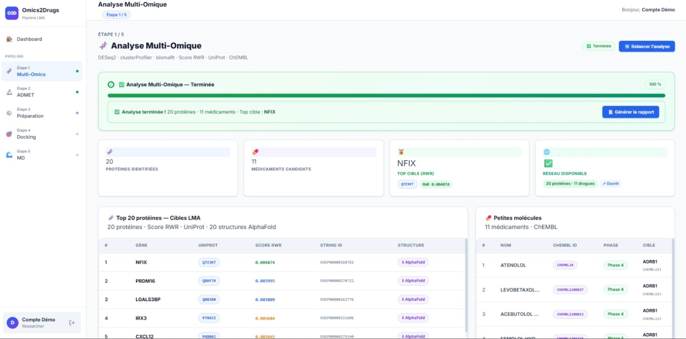

# FLT3-ITD multi-omic network: target prioritisation in acute myeloid leukemia

Integrates TCGA transcriptomic and DNA-methylation data in a heterogeneous protein–methylation network, then ranks candidate therapeutic targets for **FLT3-ITD acute myeloid leukemia (AML)** with a random walk with restart. Known drugs for the top targets are retrieved from ChEMBL, and 3D structures are collected for downstream docking.

> **Context.** This repository contains my module (**step 1 of 5**: multi-omic analysis and target prioritisation) of **Omics2Drugs**, a drug-repurposing pipeline built as a five-person end-of-year project (PFA) at UM6SS, Casablanca, in 2026. The other modules (ADMET filtering, ligand/receptor preparation, molecular docking, molecular dynamics and the web interface) were developed by my teammates.
> <!-- Optional: name teammates and supervisor here, with their agreement. -->



---

## Question

FLT3-ITD is found in roughly a quarter to a third of AML cases and is associated with a poor prognosis, relapse and resistance to FLT3 inhibitors. Which proteins sit at the centre of the transcriptional and epigenetic differences between FLT3-ITD and FLT3 wild-type patients, and are any of them already targeted by existing drugs?

## Data

| Source | Content | Access |
|---|---|---|
| cBioPortal, study `laml_tcga_pan_can_atlas_2018` | Somatic mutations (used to stratify patients) | Manual download (see *How to run*) |
| GDC, project `TCGA-LAML` | RNA-seq (STAR – Counts, TPM) | Downloaded automatically by the script (TCGAbiolinks) |
| GDC, project `TCGA-LAML` | DNA methylation (Illumina 450K, beta values) | Downloaded automatically by the script (TCGAbiolinks) |
| STRING v12 | Human protein–protein interactions (score > 700) | Queried by the script (STRINGdb) |
| ChEMBL, UniProt, RCSB PDB, AlphaFold DB | Drugs, protein IDs, 3D structures | Queried through their REST APIs |

**Cohort:** 199 patients in the study → **29 FLT3-ITD** (in-frame insertions in FLT3) vs **140 wild-type** (no FLT3 mutation) → **114 patients** with both RNA-seq and methylation (primary tumour samples).

## Method

1. **Stratification.** FLT3-ITD vs wild-type from the cBioPortal mutation file.
2. **Differential analysis (limma).**
   - RNA-seq: log2(TPM + 1), genes with adjusted p < 0.05 and |log2FC| > 1.
   - Methylation: beta values converted to M-values, probes with adjusted p < 0.05 and |ΔM| > 0.5, mapped to their annotated gene.
3. **Heterogeneous network.** STRING protein–protein interactions (confidence > 700) between the proteins of all disease genes (differentially expressed genes + genes carrying differential methylation probes), plus methylation-probe nodes linked to the protein of the gene they annotate. Final network: **1 621 nodes, 1 314 edges**.
4. **Random walk with restart (RWR).** Seeds = differential genes (weight 5) and differential probes (weight 1); restart parameter 0.85. Proteins are ranked by their stationary score, and immunoglobulin/T-cell receptor genes (IG*/TR*) are excluded.
5. **Drug layer (ChEMBL).** For the top 20 proteins, drugs with a maximum clinical phase ≥ 2 are retrieved and split into small molecules and biologics.
6. **Structures.** Human experimental structures are searched in the PDB first. If none qualifies, the AlphaFold model is downloaded.
7. **Outputs.** CSV tables and an interactive network dashboard (visNetwork / HTML).

## Results

**Top 10 targets (RWR score)**

| Rank | Gene | UniProt | Score |
|---|---|---|---|
| 1 | NFIX | Q14938 | 0.00489 |
| 2 | PRDM16 | Q9HAZ2 | 0.00401 |
| 3 | LGALS3BP | Q08380 | 0.00382 |
| 4 | IRX3 | P78415 | 0.00370 |
| 5 | CXCL12 | P48061 | 0.00368 |
| 6 | CAMK2D | Q13557 | 0.00358 |
| 7 | ANO7 | Q6IWH7 | 0.00353 |
| 8 | AGXT | P21549 | 0.00353 |
| 9 | KCNK5 | O95279 | 0.00352 |
| 10 | ADRB1 | P08588 | 0.00348 |

Full list: [`results/top20_genes_uniprot.csv`](results/top20_genes_uniprot.csv).

The top 20 group into three themes consistent with AML biology:
- **Transcription factors linked to leukemic stem cells:** PRDM16, PBX3 (HOX co-factor), IRX3/IRX5, NFIX.
- **Bone-marrow niche signalling:** CXCL12 (retention and quiescence of leukemic stem cells), LGALS3BP.
- **Neuro-immune and ion-channel axis:** β-adrenergic receptors ADRB1/ADRB2, FCGRT, KCNK5, ANO7.

**Drug layer (ChEMBL, phase ≥ 2):** 16 molecules in total.
- 11 classified as small molecules, of which 10 have usable 3D structures: β1-blockers on ADRB1 (atenolol, esmolol, acebutolol, levobetaxolol, oxprenolol) and β2-agonists on ADRB2 (albuterol, levalbuterol, vilanterol, pirbuterol, protokylol). These were passed on to the docking module.
- Biologics, mainly anti-FcRn antibodies on FCGRT (e.g. rozanolixizumab, nipocalimab, batoclimab) and olaptesed pegol on CXCL12. They are not suitable for small-molecule docking.

**Structures:** no PDB entry met the human, full-length criteria for these targets, so all 20 structures come from AlphaFold.

## Repository structure

```
.
├── R/run_multiomics.R          # full pipeline (sections 0–11)
├── results/
│   ├── top20_genes_uniprot.csv
│   ├── targets_list.txt
│   ├── small_molecule_drugs.csv
│   ├── biologic_drugs.csv
│   ├── network/chembl_drugs.csv
│   ├── network/target_to_pdb.csv
│   └── pdb_proteins/structure_report.csv
├── docs/omics2drugs_step1.jpg
├── .here                        # marks the project root for the `here` package
└── .gitignore                   # raw data and large regenerated files are not versioned
```

## How to run

Requirements: R ≥ 4.4 and an internet connection. Missing CRAN/Bioconductor packages are installed automatically by section 0 of the script.

1. Download the cBioPortal study **`laml_tcga_pan_can_atlas_2018`** and unzip it into `data/`, so that `data/laml_tcga_pan_can_atlas_2018/data_mutations.txt` exists.
2. Open the repository folder in R or RStudio. The `.here` file sets the project root.
3. Run:
   ```r
   source("R/run_multiomics.R")
   ```
   The first run downloads the TCGA-LAML RNA-seq and methylation data from GDC (several GB) and can take a while. Results are written to `results/`.

## Limitations

- **Small ITD group.** FLT3-ITD is approximated by in-frame insertions in the mutation file, and the ITD group is small compared with wild-type.
- **Prioritisation is network-based and correlative.** Targets are hypotheses to test, not validated findings.
- **Close scores.** RWR scores are close in the lower part of the top 20 (ranks 15–20 are tied), so the exact order there is not meaningful.
- **Simple methylation mapping.** Methylation probes are linked to their first annotated gene, a simplification of cis-regulation.
- **UniProt IDs differ between steps.** The top-20 table uses the first UniProt ID from org.Hs.eg.db, while the structure step re-queries the canonical reviewed UniProt entry, so IDs can differ for some genes (e.g. NFIX).
- **miRNA placeholder.** The script writes an empty `mirna_rpm.csv` placeholder, kept for compatibility with the Omics2Drugs platform.

## Licence

MIT. See `LICENSE`.
